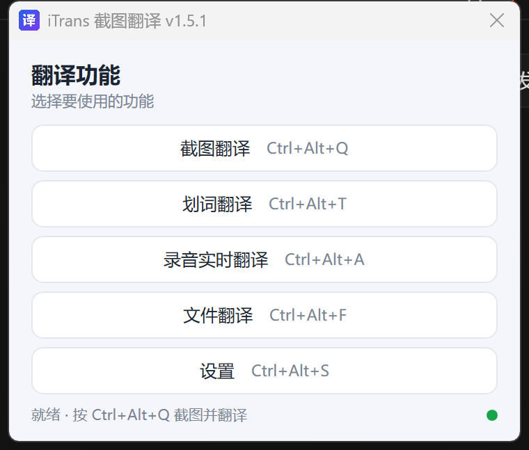
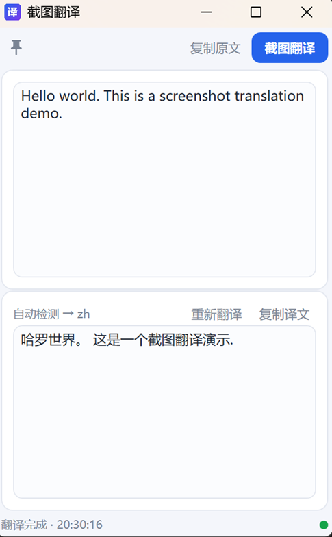
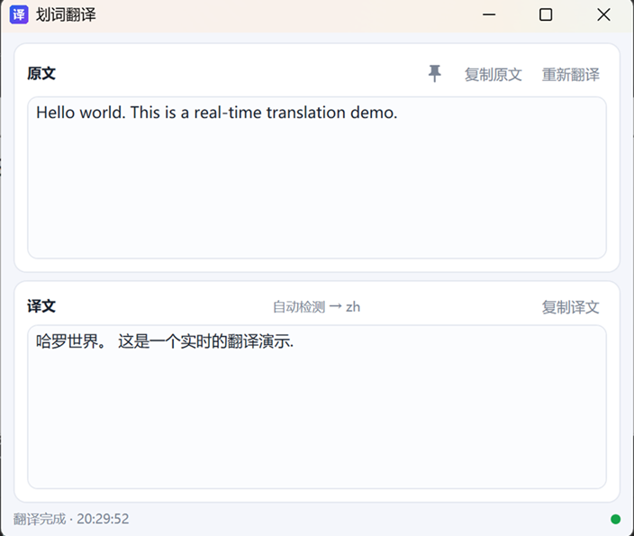
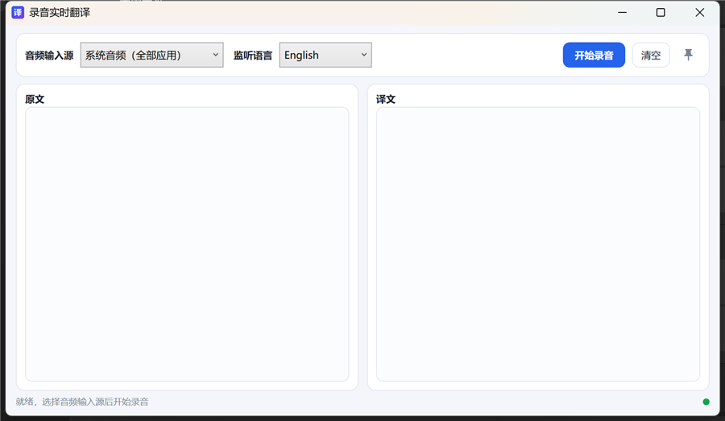
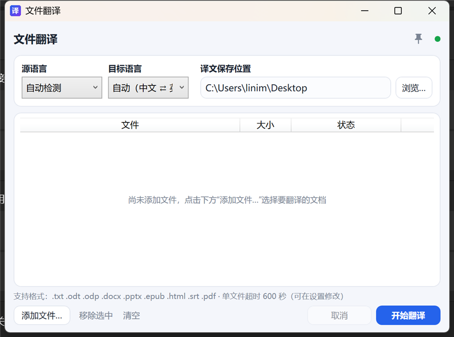
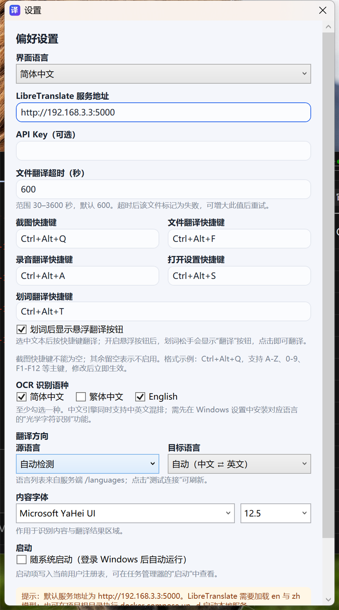

# itrans · Windows Screenshot Translation

**English** | [简体中文](README.md)

A native screenshot OCR translation tool for Windows 10 / 11: press a global hotkey to select any region of the screen, recognize text with the built-in Windows OCR engine, and translate between Chinese and English via a LibreTranslate service. The translation window is split into two panes: the recognized text on top and the translation below. Besides screenshots, it also supports uploading documents and automatically downloads translated files. The default service address is `http://192.168.3.3:5000`.

## Features

- Global hotkey (default `Ctrl+Alt+Q`) triggers region screenshot capture, with multi-monitor and arbitrary-region support
- Uses Windows built-in OCR (`Windows.Media.Ocr`) — no extra recognition service required
- Automatically detects the source language; supports translation among Chinese, English, and any other languages loaded on the server
- Recognized text is editable and can be re-translated with one click
- One-click copy of the original or translated text
- File translation: batch-upload documents, translate via LibreTranslate `/translate_file`, and automatically download the results
- Supported file formats come from the server's `/frontend/settings` `supportedFilesFormat` (currently: `.txt` `.odt` `.odp` `.docx` `.pptx` `.epub` `.html` `.srt` `.pdf`)
- Live audio translation: start/stop recording with one click, transcribe and translate in real time, with original and translation shown side by side
- Selectable listening language (default English, switchable to Chinese) used as the source language for speech recognition and audio translation
- Selectable audio input: system audio (all apps), per-application audio (Windows 10 2004+), or microphone / hardware input
- Speech-to-text uses Windows built-in speech recognition (SAPI) — no extra recognition service required; third-party APIs can be integrated later
- Text selection translation: select text by mouse drag, double-click, or keyboard, then press the hotkey — or click the floating "Translate" button that appears after selecting, to view the original and translation in a new window
- Every translation window has a pin button to keep it always on top; click again to unpin
- Custom font and font size for recognized and translated content
- Selectable OCR languages: Simplified Chinese, Traditional Chinese, English
- Selectable source/target languages, with "Auto (Chinese ⇄ English)" available as target; the language list is fetched dynamically from the server's `/languages` and can be refreshed via "Test connection" in Settings
- Multilingual UI: Simplified Chinese, Traditional Chinese, English, Japanese, German, French — switch instantly in Settings without restarting; strings are maintained in embedded JSON
- Launch at system startup (writes a startup entry to the current user's registry)
- The main window is a feature menu: open Screenshot Translation, Text Selection Translation, Live Audio Translation, File Translation, and Settings; ships with a 256px high-resolution icon (`src/Itrans/Assets/itrans.ico`)
- After closing or minimizing the main window, the app keeps running in the system tray
- Tray menu: Screenshot Translation, Text Selection Translation, Live Audio Translation, File Translation, Show Main Window, Settings, Exit — each showing its hotkey
- Every feature window shows the translation service status: green dot when healthy, red dot when unhealthy, hover for details; the app calls `/health` every 30 seconds
- Service address, API key, hotkeys, OCR languages, UI language, translation source/target languages, file translation timeout, font, and launch-at-startup are all configurable in Settings
- Customizable hotkeys: screenshot (required), file translation, audio translation, text selection translation, open settings (the latter four can be left empty to disable); optional floating translate button after text selection
- Default hotkeys: screenshot `Ctrl+Alt+Q`, text selection `Ctrl+Alt+T`, audio `Ctrl+Alt+A`, file `Ctrl+Alt+F`, settings `Ctrl+Alt+S`
- The main window title shows the app name and version (from `<Version>` in the project file, currently v1.5.1)

## Screenshots

The main window is a feature menu; every translation window has a pin button to keep it always on top.

<p>
  
  
</p>

<p>
  
  
</p>

<p>
  
  
</p>

For more screenshots and detailed feature descriptions, see [docs/介绍.md](docs/介绍.md) (Chinese).

## Requirements

- Windows 10 1809+ or Windows 11
- .NET 10 Desktop Runtime (x64): required to run the published build; download from the official site: <https://dotnet.microsoft.com/download/dotnet/10.0>
- Windows OCR language packs: install Chinese (Simplified/Traditional) and English as needed
  - Settings → Time & language → Language & region → Add a language
  - Install "Optical character recognition" (OCR) in the language options
- Windows speech recognition language packs (for live audio translation): install the required languages in "Settings → Time & language → Speech"; at least one speech recognizer must be available on the system
  - Per-application audio capture requires Windows 10 version 2004 (19041) or later
  - Microphone input requires allowing apps to access the microphone in Windows privacy settings
- Docker Desktop (to run LibreTranslate)

## Translation Service

By default it connects to the LAN service `http://192.168.3.3:5000`, which can be changed in Settings. The service must expose the following LibreTranslate-compatible endpoints:

- `GET /languages` and `GET /frontend/settings`
- `POST /translate`
- `POST /translate_file` (`multipart/form-data`: `file`, `source`, `target`, optional `api_key`)
- The file translation response is JSON `{ "translatedFileUrl": "..." }`; the app then `GET`s that URL to download the result

To run the service locally, a `docker-compose.yml` is provided at the project root:

```bat
docker compose up -d
```

- Listens on `http://localhost:5000` by default; set the service address to `http://localhost:5000` in Settings
- The first start downloads the en / zh models, which may take several minutes; watch progress with `docker compose logs -f`
- Loaded languages are restricted to en/zh via `LT_LOAD_ONLY=en,zh`

## Build & Run

```bat
dotnet run --project src/Itrans
```

Publish as a single file (the target machine must have the .NET 10 Desktop Runtime installed):

```bat
dotnet publish src/Itrans -c Release -r win-x64 --self-contained false -p:PublishSingleFile=true -o publish
```

The resulting executable is `publish/Itrans.exe`. This publish mode no longer embeds the .NET runtime, significantly reducing size; install the official .NET 10 Desktop Runtime (x64) before the first run. If it is missing, a prompt with the official download link is shown at startup.

You can also simply run `build.bat` at the project root (double-click it); the script checks the SDK, performs the publish, and pauses with the result on success or failure. If it reports that `publish\Itrans.exe` is in use, exit any running Itrans first. Pass `--nopause` to skip the final pause on the command line.

## Usage

1. Launch `Itrans.exe`; the main window shows the feature menu and a tray icon. Clicking a menu item opens the corresponding window.
2. Click "Screenshot Translation" or press `Ctrl+Alt+Q`; the screen dims — drag the mouse to select a region.
   - Press `Esc` or right-click to cancel.
3. Release the mouse to run OCR and translation automatically; results appear in the screenshot translation window.
4. Text selection translation: select text in any app (mouse drag, double-click, or keyboard selection), press the selection hotkey (default `Ctrl+Alt+T`), or click the floating "Translate" button that appears after selecting; the original and translation are shown in a new window.
5. Closing the main window only hides it to the tray; the app keeps running. Choose "Exit" from the tray menu to quit.

## File Translation

1. Click "File Translation" in the main window feature menu or the tray menu.
2. Choose source and target languages (auto-detect / auto Chinese ⇄ English available; the language list comes from the server's `/languages`).
3. Click "Add files…" to select multiple documents at once; the window shows the translation save location — Desktop by default on first use, then remembers the last chosen directory (you can also click "Browse…" to change it).
4. Click "Start translation"; files are uploaded one by one and the translations downloaded automatically. Double-click a list item to reveal the file in Explorer.
5. Supported formats are defined by the server; currently `.txt` `.odt` `.odp` `.docx` `.pptx` `.epub` `.html` `.srt` `.pdf`.
6. Each file waits up to 600 seconds by default, adjustable in Settings (30–3600 seconds). The server's web file translation request has no timeout by default; `frontendTimeout` (500) is only a debounce for text input and is unrelated to file translation.

Translation requests follow the LibreTranslate spec: `POST /translate_file` uses `multipart/form-data` with `file`, `source` (language code or `auto`), `target`, and optional `api_key`; after it returns `translatedFileUrl`, the app downloads and saves the result.

## Live Audio Translation

1. Click "Live Audio Translation" in the main window feature menu or the tray menu.
2. Choose an audio input source:
   - System audio (all apps): capture sound from the default playback device
   - Application audio: choose an app currently playing sound (requires Windows 10 2004 / 19041 or later)
   - Microphone / hardware input: choose an available recording device
3. Choose the "Listening language" (default English, switchable to Chinese) and click "Start recording". Speech-to-text uses Windows built-in speech recognition (SAPI); if the matching language pack is missing, it automatically falls back to an installed recognizer and shows a notice.
4. The original text appears live on the left and the translation on the right by paragraph, with matching numbers; the listening language is used as the source language for audio translation, and the target language follows the Settings selection.
5. Click "Stop recording" to end capture; "Clear" removes the current original and translated text.

## Text Selection Translation

1. Select the text to translate in a browser, Notepad, or any other app that supports text selection (mouse drag, double-click, or keyboard selection).
2. Press the selection hotkey (default `Ctrl+Alt+T`), or enable "Show floating translate button after selection" in Settings and click the "Translate" button that appears where you release the selection.
3. The app tries to read the current selection; some apps do not support automation reads, so it simulates copy instead, which may write the selected text to the clipboard.
4. The original and translation are shown in a new window; you can edit the original and re-translate, or copy either with one click.
5. Both the selection hotkey and floating button can be configured or disabled in Settings.

## Settings

Click "Settings" in the main window feature menu or the tray menu to change:

- LibreTranslate service address (default `http://192.168.3.3:5000`)
- API Key (may be required by public instances)
- UI language: Simplified Chinese, Traditional Chinese, English, Japanese, German, French — applied immediately after saving
- Screenshot hotkey (format like `Ctrl+Alt+Q`; supports A-Z, 0-9, F1-F12, etc.)
- File translation / audio translation / text selection translation / open settings hotkeys: optional, left empty to disable; duplicate combinations trigger a conflict notice
- Show floating translate button after selection: when enabled, selecting text and releasing the mouse shows a "Translate" button nearby
- The hotkey area uses a 2×2 layout (text selection on its own row); click the input and press the combination to record it; `Backspace` / `Delete` / `Esc` clears it
- OCR languages: Simplified Chinese, Traditional Chinese, English — multi-select (at least one)
- Translation source / target languages: "Auto-detect" and "Auto (Chinese ⇄ English)" available; the language list comes from the server's `/languages`; click "Test connection" to refresh
- File translation timeout: maximum wait per file, default 600 seconds, range 30–3600 seconds
- File translation save location: Desktop by default on first use, then remembers the last chosen directory (stored in `%APPDATA%\Itrans\settings.json`)
- Content font and font size (system-installed fonts; size 8–72)
- Launch at system startup: run automatically after signing in to Windows

Settings are stored in `%APPDATA%\Itrans\settings.json`.

## FAQ

- **Hotkey does not work**: it may be taken by another app — choose a different one; a tray notification appears if registration fails.
- **No text recognized / missing language pack**: install the "Optical character recognition" optional feature for Chinese (Simplified) in Windows language settings.
- **Translation fails**:
  - Make sure LibreTranslate is running: open `http://localhost:5000/languages` in a browser
  - Click "Test connection" in Settings to check whether the Chinese and English models are loaded
  - The first Chinese translation may require LibreTranslate to download the Argos Chinese model from the internet
- **Translation service requires authentication**: enter the API Key in Settings.
- **File translation fails**: make sure file translation is enabled on the server (`filesTranslation` is `true` and `supportedFilesFormat` is non-empty in `/frontend/settings`), and check whether the file exceeds the server's size limit; unsupported extensions are skipped when added.
- **File translation times out**: large files may take longer; the default timeout is 600 seconds — increase it up to 3600 seconds in Settings and retry.
- **Live audio translation shows no results**: make sure a speech recognition language pack is installed in "Settings → Time & language → Speech" and that the source language in the app matches the audio; application audio requires Windows 10 2004+, and microphone use requires allowing apps to access the microphone in Windows privacy settings.
