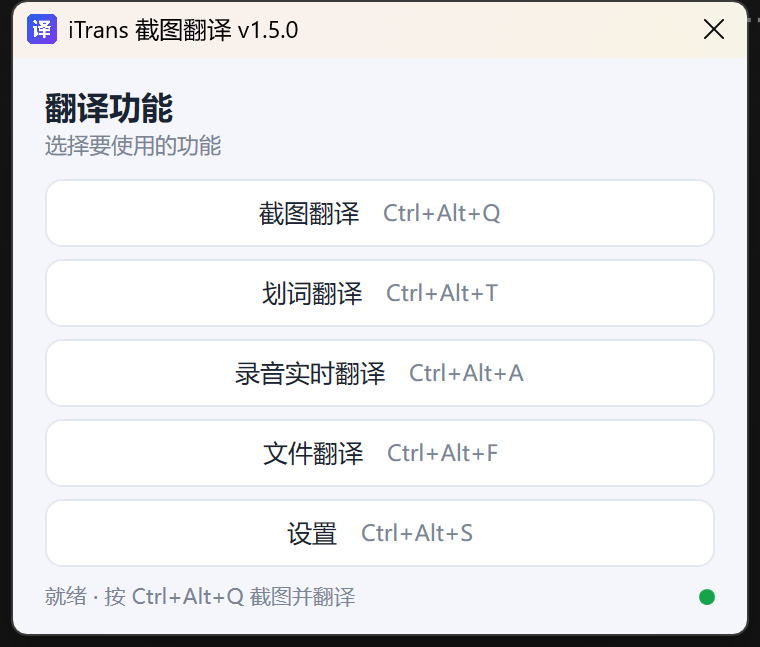
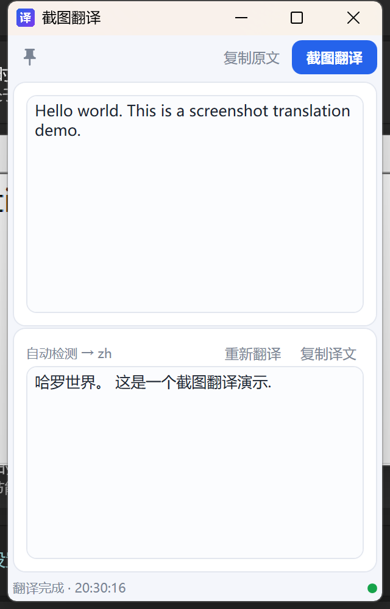
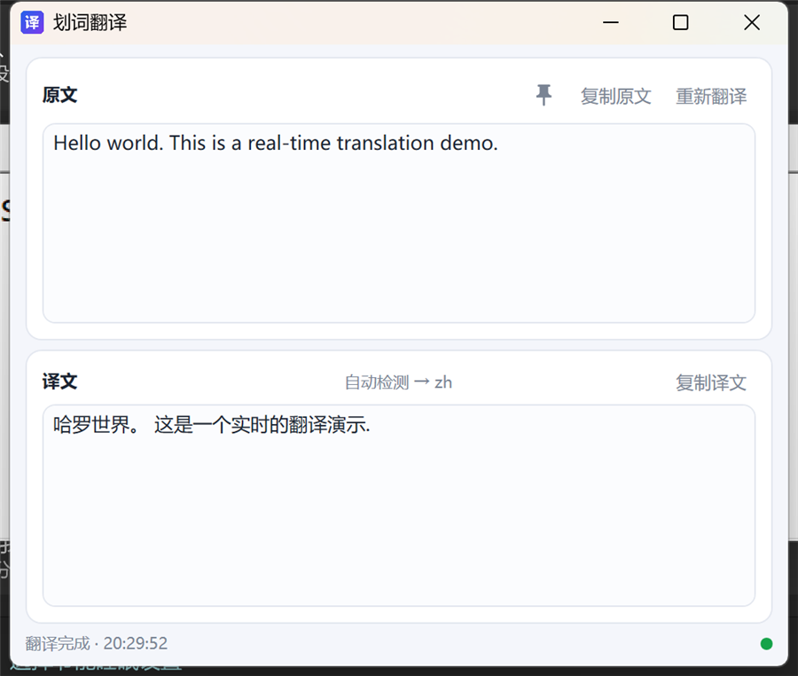
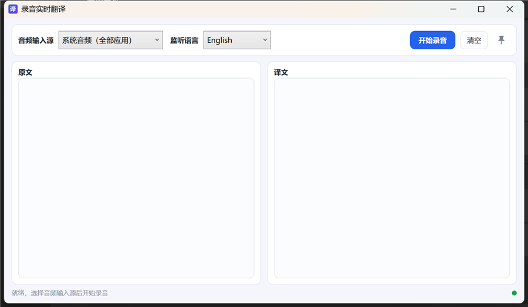
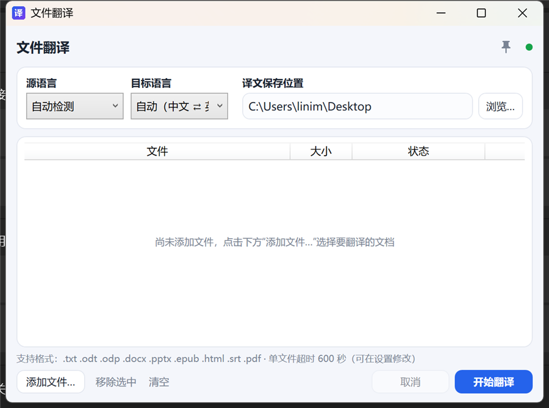
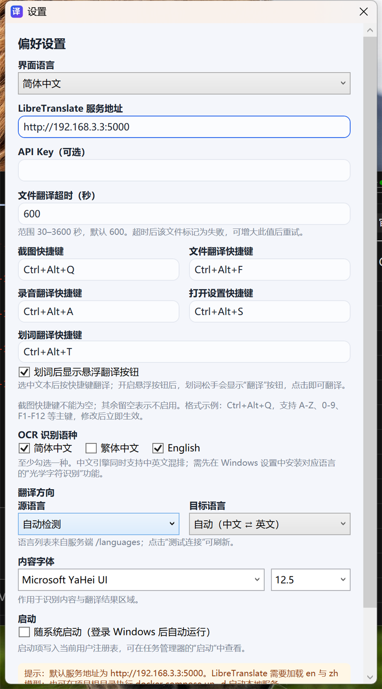

# iTrans 截图翻译 v1.5.0

iTrans 是一个面向 Windows 的截图 OCR 翻译与实时翻译工具。它支持截图翻译、划词翻译、录音实时翻译和文件翻译，并可将结果窗口置顶显示，方便在阅读、观看视频或处理文档时随时查看译文。

## 功能概览

- 截图翻译：框选屏幕区域，使用 Windows 自带 OCR 识别文字并翻译。
- 划词翻译：选中任意应用中的文本后按快捷键翻译，或点击划词后出现的悬浮按钮。
- 录音实时翻译：采集系统音频、应用音频或麦克风，使用系统语音识别实时转写并逐段翻译。
- 文件翻译：批量上传文档，通过 LibreTranslate 翻译并自动下载译文。
- 置顶显示：各翻译窗口提供钉子图标按钮，点击后固定显示在所有窗口最前面。
- 多语言界面：简体中文、繁體中文、English、日本語、Deutsch、Français。
- 托盘菜单：集中显示全部翻译功能及对应快捷键。
- 自定义快捷键：截图、划词、录音、文件翻译和打开设置均可单独配置。

## 界面预览

### 主界面

功能菜单集中展示所有翻译入口，并在每个入口旁显示当前快捷键。

### 截图翻译

框选屏幕区域后自动 OCR 并翻译，原文和译文上下显示；支持重新翻译、复制原文/译文和置顶。

### 划词翻译

在任意应用中选中文本后按快捷键，或点击划词处的悬浮按钮，即可在新窗口查看原文和译文。

### 录音实时翻译

可选择系统音频、应用程序音频或麦克风输入，并选择监听语言。识别出的原文与译文左右并排显示。

### 文件翻译

支持批量添加文档、选择源语言与目标语言、设置译文保存位置；支持外部拖拽文件。

### 设置

设置界面包含界面语言、服务地址、快捷键、OCR 语种、翻译语言、字体和开机启动等选项。快捷键区域采用 2×2 布局，并支持按键监听录入。

## 置顶功能

每个翻译窗口都提供钉子图标按钮：

- 点击钉子图标后，窗口会固定显示在所有其他窗口最前面。
- 置顶状态下钉子图标会旋转并高亮显示，表示窗口已固定；再次点击可取消置顶。
- 置顶状态只在当前窗口打开期间有效；重新打开窗口会恢复普通显示。

## 快捷键

| 功能 | 默认快捷键 |
| --- | --- |
| 截图翻译 | `Ctrl+Alt+Q` |
| 划词翻译 | `Ctrl+Alt+T` |
| 录音实时翻译 | `Ctrl+Alt+A` |
| 文件翻译 | `Ctrl+Alt+F` |
| 打开设置 | `Ctrl+Alt+S` |

所有快捷键都可以在设置中修改；除截图快捷键外，其余快捷键留空表示不启用。设置界面点击快捷键输入框后直接按下组合键即可录入，`Backspace` / `Delete` / `Esc` 清除。

## 托盘菜单

右键单击托盘图标可看到：

- 截图翻译
- 划词翻译
- 录音实时翻译
- 文件翻译
- 显示主窗口
- 设置
- 退出

每个功能菜单项后会显示当前快捷键。

## 运行要求

- Windows 10 1809+ 或 Windows 11（x64）。
- .NET 10 Desktop Runtime（x64）：<https://dotnet.microsoft.com/download/dotnet/10.0>
- 截图 OCR 需要安装对应的 Windows OCR 语言包。
- 录音实时翻译需要安装 Windows 语音识别语言包；应用音频采集需要 Windows 10 2004（19041）及以上。
- 翻译功能需要可访问的 LibreTranslate 服务，默认地址为 `http://192.168.3.3:5000`。

## 翻译服务

程序默认连接 `http://192.168.3.3:5000`，可在设置中修改。服务需提供 LibreTranslate 兼容接口：

- `GET /health`
- `GET /languages`、`GET /frontend/settings`
- `POST /translate`
- `POST /translate_file`

项目根目录提供 `docker-compose.yml`，可执行 `docker compose up -d` 启动本地服务。
